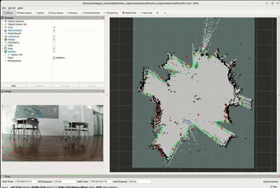
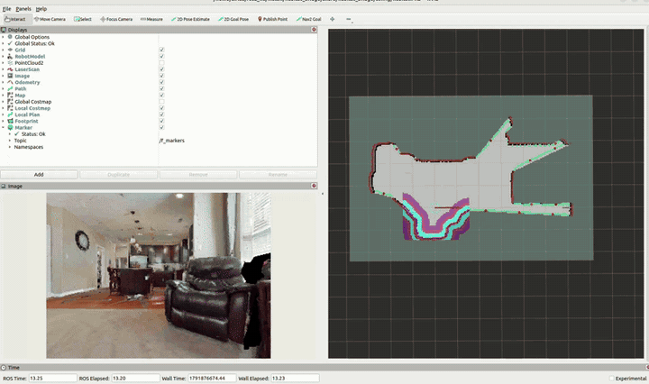

# go2_frontier_exploration
Autonomous Frontier Exploration and SLAM Navigation using ROS 2 for Unitree Go2.

The same exploration stack runs on the real robot and in simulation:

| | where | docs |
|---|---|---|
| **Unitree Go2** | `frontier_exploration` + Nav2 + slam_toolbox | [below](#go2-real-robot) |
| **HM3D in Habitat-sim** (single floor) | `habitat_bridge` replaces the robot, LiDAR and map | [habitat_bridge/README.md](habitat_bridge/README.md) |

## Repository structure

```
go2_frontier_exploration/
├── frontier_interfaces/              # FrontierGoal.srv (request the N-th best frontier)
├── frontier_exploration/             # frontier detection + exploration loop (robot independent)
│   ├── src/classical_frontier_detector.cpp   # /map -> frontier regions -> goal service
│   ├── src/frontier_utils.cpp                # frontier cells, clustering, selection
│   ├── frontier_exploration/
│   │   ├── frontier_exploration_node.py      # request goal -> Nav2 -> repeat, blacklist
│   │   └── robot_navigator.py                # Nav2 action client
│   ├── launch/frontier_exploration.launch.py     # Go2: RViz + detector + explorer
│   ├── launch/classical_exploration.launch.py    # detector + explorer (no RViz)
│   ├── config/nav2.yaml                          # Go2 Nav2 parameters
│   └── rviz/frontier.rviz
├── habitat_bridge/                   # HM3D / Habitat-sim bridge (see its README)
│   ├── scripts/habitat_server.py             # conda side: scene, virtual LiDAR, motion
│   ├── habitat_bridge/bridge_node.py         # ROS side: /clock /odom /tf /scan /map
│   ├── habitat_bridge/gt_mapper.py           # occupancy grid from the exact sim pose
│   ├── launch/hm3d_single_floor_exploration.launch.py
│   └── config/                               # Nav2, slam_toolbox, RViz for HM3D
├── learned_frontier_detector/        # YOLOv5-based frontier detector (optional)
└── docs/images/                      # result images used in the READMEs
```

## Quick start

Build (ROS 2 Humble, Ubuntu 22.04):

```bash
mkdir -p ~/ros2_ws/src && cd ~/ros2_ws/src
git clone https://github.com/gladgaeun/go2_frontier_exploration.git
cd ~/ros2_ws && source /opt/ros/humble/setup.bash
colcon build --symlink-install && source install/setup.bash
```

## Go2 (real robot)

Requires [go2_ros2_sdk](https://github.com/abizovnuralem/go2_ros2_sdk) (package `go2_robot_sdk`),
which brings up the robot driver, LiDAR, SLAM and Nav2. Follow its README to install and build it
in a separate workspace (e.g. `~/go2_ws`), then build this repository in the same workspace.

**Terminal 1** — start the Go2 SDK with Nav2, then close the RViz window it opens
(Terminal 2 opens its own RViz with the frontier markers):

```bash
ros2 launch go2_robot_sdk robot.launch.py nav2:=true
```

**Terminal 2** — start frontier exploration (RViz + frontier detector + exploration node):

```bash
cd ~/go2_ws
source install/setup.bash
ros2 launch frontier_exploration frontier_exploration.launch.py
```

**Optional** — print the best frontier goal (rank 0) without moving the robot:

```bash
ros2 service call /frontier_pose frontier_interfaces/srv/FrontierGoal "{goal_rank: 0}"
```

**Save the map** after exploration:

```bash
ros2 run nav2_map_server map_saver_cli -f ~/my_go2_map
```

### Results on Go2

<p align="center">
  
</p>
<p align="center"><em>Frontier-based exploration with Unitree Go2 in an indoor environment.</em></p>

## HM3D (Habitat-sim)

Requires [Habitat-sim](https://github.com/facebookresearch/habitat-sim) 0.3.0 in a conda env and
the HM3D dataset. See [habitat_bridge/README.md](habitat_bridge/README.md) for installation and
dataset download.

**Terminal 1** — start the Habitat simulator server (conda env) and wait for
`listening on tcp://127.0.0.1:5555`:

```bash
conda activate habitat
python ~/ros2_ws/src/go2_frontier_exploration/habitat_bridge/scripts/habitat_server.py \
    --scene ~/data/versioned_data/hm3d-0.2/hm3d/val/00800-TEEsavR23oF/TEEsavR23oF.basis.glb
```

**Terminal 2** — start the bridge, Nav2 and frontier exploration (RViz + frontier detector +
exploration node), in a new terminal without conda:

```bash
cd ~/ros2_ws
source install/setup.bash
ros2 launch habitat_bridge hm3d_single_floor_exploration.launch.py
```

**Optional** — repeat the same run with the start pose printed in Terminal 1:

```bash
python ~/ros2_ws/src/go2_frontier_exploration/habitat_bridge/scripts/habitat_server.py \
    --scene <scene.basis.glb> --start -9.457,0.163,-0.633,-1.566
```

**Save the map** after `Exploration complete!` (while Terminal 1 is still running):

```bash
ros2 run nav2_map_server map_saver_cli -f ~/my_hm3d_map
```

### Results on HM3D

Single-floor frontier-based exploration in Habitat-sim on HM3D scene `00800-TEEsavR23oF` (ground floor).
The robot maps the whole floor and stops by itself when no frontier is left.

**RViz legend**

| Marker | Meaning |
| --- | --- |
| Red arrow (Odometry) | Current robot position and heading |
| Light-blue circle (Footprint) | Robot outline as seen by Nav2; should move together with the arrow |
| Semi-transparent colored map (Local Costmap) | 3×3 m obstacle map around the robot; should move with the robot |
| Green line / pink line | Global path / local path |
| Green dots | Frontier cells |
| Red dots | Clustered frontier centroids |

<p align="center">
  
</p>
<p align="center"><em>4.5x speed. Left: robot camera view. Right: occupancy map with the markers listed in the RViz legend.</em></p>

| Scene | Exploration time (sim) | Path length | Failed goals | Mapped free area |
|---|---|---|---|---|
| `00800-TEEsavR23oF` | ~4 min (237–253 s) | 52.6–55.5 m | 0 | 51.3 m² |

## Acknowledgements

This repository builds upon and modifies the original frontier exploration implementation by Adrian Sochaniwsky:
* **Original Repository:** [adrian-soch/frontier_exploration](https://github.com/adrian-soch/frontier_exploration)
* **License:** BSD 3-Clause License (Copyright (c) 2023, Adrian Sochaniwsky)

I modified and ported the code for Unitree Go2 quadruped robot navigation using ROS 2 Nav2,
and added a Habitat-sim bridge to run the same stack on HM3D scenes.

HM3D scenes are not included; see the
[HM3D terms of use](https://matterport.com/habitat-matterport-3d-research-dataset).
